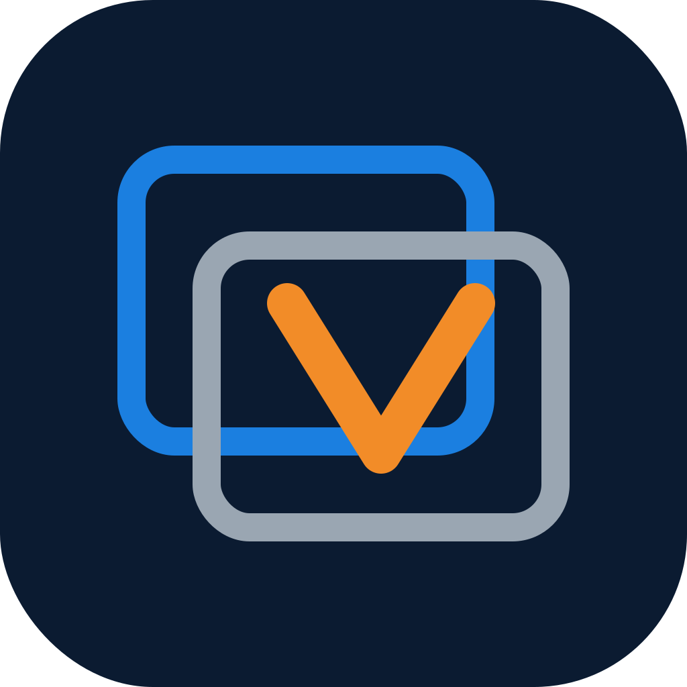
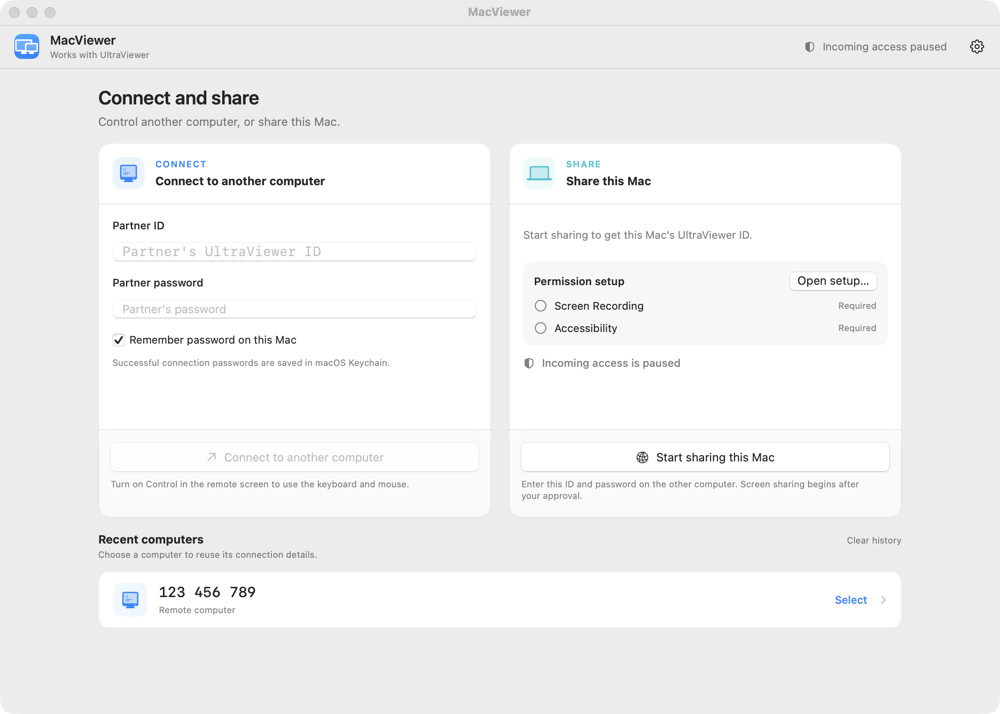

# MacViewer Ventura

**Client UltraViewer cho macOS và Linux: điều khiển máy Windows từ xa, và ngược lại.**
 
An UltraViewer client for macOS and Linux: control a Windows machine remotely, and vice versa.

[Tải bản mới nhất · Download the latest release](https://github.com/ArtyormSatori/MacViewer-Ventura/releases/latest)

[Tiếng Việt](#tiếng-việt) · [English](#english)

---

## Tiếng Việt

### Tổng quan

UltraViewer chỉ có bản Windows. MacViewer Ventura là client mã nguồn mở để kết nối tới các máy đó từ **macOS 13 Ventura trở lên** và từ **Linux**: nhập ID + mật khẩu của máy đích là xem màn hình và điều khiển được ngay; máy của bạn cũng có thể làm máy được điều khiển, sau khi bạn duyệt.

Đây không phải sản phẩm chính thức của UltraViewer. Chỉ kết nối tới máy bạn được phép truy cập.

Trạng thái: dự án đang được phát triển tích cực. Lộ trình và các giới hạn đã đo: [FEATURE_ROADMAP.md](FEATURE_ROADMAP.md).

### Tải về

Mọi file đều nằm tại trang [Releases](https://github.com/ArtyormSatori/MacViewer-Ventura/releases/latest).

| Nền tảng | File | Kiểm chứng |
|---|---|---|
| macOS 13+ (Intel + Apple Silicon) | `MacViewer-Ventura-<phiên bản>-macOS.dmg` (khuyên dùng) hoặc `MacViewer-Ventura-<phiên bản>-macOS.zip` | Đối chiếu với `SHA256SUMS-macOS.txt` trong cùng release |
| Linux (x86-64) | `MacViewer-Ventura-<phiên bản>-Linux.tar.gz` hoặc `MacViewer-Ventura-<phiên bản>-Linux-amd64.deb` | File `.sha256` đi kèm từng file |

### App làm gì

- **Viewer:** nhập ID + mật khẩu của máy đang chạy UltraViewer/MacViewer → xem màn hình, điều khiển chuột và bàn phím.
- **Host:** cho máy khác kết nối vào máy của bạn, sau khi bạn duyệt (quyền xem và quyền điều khiển cấp riêng).
- **Đường truyền:** TLS qua relay của UltraViewer; hai máy cùng LAN thì kết nối trực tiếp.
- **Chế độ Tự host (từ bản 5.0):** hai máy cùng chạy MacViewer Ventura kết nối qua máy chủ mesh do bạn tự vận hành — hình ảnh truyền trực tiếp giữa hai máy bằng WebRTC (mã hoá đầu cuối, có huy hiệu Trực tiếp/Qua relay ngay trong phiên), điều khiển từ xa và chat dùng chung một cửa sổ. Cách dựng máy chủ: xem [SELF_HOSTING.md](SELF_HOSTING.md).
- **Phụ trợ:** chat, clipboard văn bản hai chiều, chụp màn hình + ghi chú, quay video phiên, nghe âm thanh của máy kia, lưu mật khẩu đối tác vào Keychain.

### Điểm nổi bật

- **Chạy trên macOS 13 Ventura** (deployment target 13.0) — Intel và Apple Silicon; kèm bản dựng Linux.
- **Giao diện làm mới ở bản 5.0:** biểu tượng app mới, cửa sổ chính mang tên MacViewer Ventura, hỗ trợ đủ giao diện sáng và tối (theo hệ thống hoặc tự chọn trong Cài đặt), chuyển ngôn ngữ Tiếng Việt/English ngay trong Cài đặt.
- **Chứng thư relay nhúng sẵn:** chứng thư gốc Sectigo R46 được nhúng làm trust anchor bổ sung, nên máy Ventura kết nối relay ngay mà không cần nạp chứng thư thủ công; neo hệ thống và cơ chế ghim tên chứng thư giữ nguyên.
- **Điều khiển bật mặc định** khi kết nối (máy host vẫn là bên quyết định quyền).
- **Chất lượng hình:** app yêu cầu máy Windows gửi hình về theo một mức nét, có ba mức sẵn: **Ưu tiên tốc độ (30)** — mượt trên mạng yếu nhưng hình mờ hơn; **Tự động (45)**; **Ưu tiên chất lượng (70)** — hình nét nhất, tốn băng thông hơn. Ngay khi kết nối, app tự chọn mức Ưu tiên chất lượng (70) để hình nét ngay; bạn đổi mức bất cứ lúc nào trong Cài đặt.
- **Tự cập nhật trong app:** bản tải về được đối chiếu SHA-256 với bảng tổng công bố, cài đè tại chỗ và tự mở lại; bản cài qua app không còn cảnh báo Gatekeeper (từ bản 3.0).
- **Truy cập không người trực** (mặc định tắt): tự duyệt sau khi bằng chứng mật khẩu khớp; tuỳ chọn mở cùng lúc đăng nhập và chống ngủ khi chia sẻ.
- **Bàn phím:** keycode US, VNI passthrough, văn bản Unicode (Cài đặt → Bàn phím).
- **Hình phía host:** dithering Bayer 4×4; nhịp chụp thích ứng 50–1000 ms.
- **Mật khẩu đối tác** lưu Keychain với mức `kSecAttrAccessibleWhenUnlockedThisDeviceOnly`.

Chi tiết kỹ thuật: [VENTURA.md](VENTURA.md).

### Ảnh màn hình

 Cửa sổ chính — giao diện tiếng Việt

 

 Cửa sổ chính — giao diện tiếng Anh

### Yêu cầu hệ thống

| | Yêu cầu |
|---|---|
| macOS | 13 Ventura trở lên, chip Intel hoặc Apple Silicon |
| Linux | x86-64, bản `.tar.gz` hoặc gói `.deb` |
| Quyền trên máy host (macOS) | **Ghi màn hình** và **Trợ năng**, cấp khi app yêu cầu |
| Mạng | Truy cập được relay của UltraViewer, hoặc hai máy cùng LAN |

### Cài đặt (macOS)

1. Tải `MacViewer-Ventura-<phiên bản>.dmg` (hoặc `.zip`) ở [Releases](https://github.com/ArtyormSatori/MacViewer-Ventura/releases/latest).
2. Kéo `MacViewer.app` vào thư mục **Applications**.
3. Mở lần đầu: **chuột phải → Open → Open**. (Hoặc: `xattr -dr com.apple.quarantine /Applications/MacViewer.app`)
4. Chỉ khi làm host: cấp quyền **Ghi màn hình** và **Trợ năng** theo hướng dẫn trong app.

Chi tiết từng bước: [readme.txt](readme.txt).

### Cập nhật

App tự kiểm tra bản mới tại repo này. Khi có bản mới, bấm **Cập nhật và khởi động lại**: app tải về, kiểm SHA-256, cài đè và tự mở lại.

### Giới hạn

- **Không truyền file tới máy chạy UltraViewer:** UltraViewer hiện chưa hỗ trợ truyền file trong giao thức của nó, nên app không gửi được file tới máy đang chạy UltraViewer — điều này không thay đổi được từ phía app. **Truyền file sẽ đến trong một bản cập nhật sau 5.0, và cũng chỉ hoạt động khi cả hai máy cùng chạy MacViewer Ventura**; nếu một bên dùng UltraViewer thì vẫn không truyền file được. Xem [FEATURE_ROADMAP.md](FEATURE_ROADMAP.md).
- **Màu hình bị giới hạn bởi giao thức:** UltraViewer truyền hình bằng màu RGB555 và ảnh JPEG, nên độ nét không thể bằng các phần mềm dùng luồng video H.264/UDP như RustDesk.
- **Khi máy Mac làm máy được điều khiển (host):** ảnh màn hình gửi đi không kèm con trỏ chuột, do giới hạn của API chụp hình trên macOS 13.
- **App được ký dạng ad-hoc:** lần cài thủ công đầu tiên phải mở bằng chuột phải → Open; các bản cập nhật cài qua app thì không cần bước này.

### Báo lỗi & giúp kiểm thử

Gặp lỗi? Mở [issue](https://github.com/ArtyormSatori/MacViewer-Ventura/issues/new/choose) theo mẫu có sẵn — cho biết phiên bản, triệu chứng, và kết nối bao lâu thì gặp. Muốn giúp kiểm thử bài bản hơn (thử để yên, thử phiên dài, thử nối lại): xem [BAO_LOI_VA_KIEM_THU.md](BAO_LOI_VA_KIEM_THU.md).

### Tài liệu

| File | Nội dung |
|---|---|
| [readme.txt](readme.txt) | Cài đặt, cấp quyền, sử dụng |
| [BAO_LOI_VA_KIEM_THU.md](BAO_LOI_VA_KIEM_THU.md) | Cách kiểm thử và báo lỗi |
| [VENTURA.md](VENTURA.md) | Chi tiết kỹ thuật |
| [SECURITY_AUDIT.md](SECURITY_AUDIT.md) | Rà soát bảo mật |
| [FEATURE_ROADMAP.md](FEATURE_ROADMAP.md) | Lộ trình tính năng, giới hạn đã đo |
| [SELF_HOSTING.md](SELF_HOSTING.md) | Hướng dẫn tự dựng máy chủ cho chế độ Tự host |

### Build từ mã nguồn

Máy build cần macOS 14.5+ và Xcode 16 (app build ra chạy trên macOS 13+). GitHub Actions chạy toàn bộ test và đóng gói bản universal mỗi lần push lên `main`. Xem [VENTURA.md](VENTURA.md).

### Quyền riêng tư

Không thu thập dữ liệu. Kiểm tra cập nhật chỉ đọc thông tin công khai trên GitHub (tắt được trong Cài đặt). Mật khẩu chỉ lưu vào Keychain khi người dùng chọn; lịch sử kết nối chỉ lưu ID.

### Giấy phép

Dựa trên dự án mã nguồn mở MacViewer của DeanOpen.

Giấy phép MIT — xem [LICENSE](LICENSE). Thư viện bên thứ ba giữ giấy phép riêng: [THIRD_PARTY_NOTICES.md](THIRD_PARTY_NOTICES.md). File `8bit.dat` là dữ liệu của UltraViewer, không thuộc MIT. UltraViewer là thương hiệu của chủ sở hữu tương ứng.

---

## English

### Overview

UltraViewer ships for Windows only. MacViewer Ventura is an open-source client that connects to those machines from **macOS 13 Ventura and later** and from **Linux**: enter the target machine's ID + password to view and control it right away; your machine can also be the one being controlled, after you approve.

Not an official UltraViewer product. Connect only to machines you are permitted to access.

Status: the project is under active development. Roadmap and measured limits: [FEATURE_ROADMAP.md](FEATURE_ROADMAP.md).

### Download

All files are on the [Releases](https://github.com/ArtyormSatori/MacViewer-Ventura/releases/latest) page.

| Platform | File | Verification |
|---|---|---|
| macOS 13+ (Intel + Apple Silicon) | `MacViewer-Ventura-<version>-macOS.dmg` (recommended) or `MacViewer-Ventura-<version>-macOS.zip` | Check against `SHA256SUMS-macOS.txt` in the same release |
| Linux (x86-64) | `MacViewer-Ventura-<version>-Linux.tar.gz` or `MacViewer-Ventura-<version>-Linux-amd64.deb` | Per-file `.sha256` sidecar |

### What the app does

- **Viewer:** enter the ID + password of a machine running UltraViewer/MacViewer → view its screen, control mouse and keyboard.
- **Host:** let another machine connect to yours after you approve (view and control permissions granted separately).
- **Transport:** TLS via UltraViewer's relay; machines on the same LAN connect directly.
- **Self-hosted mode (from version 5.0):** two machines running MacViewer Ventura connect through a mesh server you operate yourself — the picture travels directly between the two machines over WebRTC (end-to-end encrypted, with a Direct/Relay badge in the session), with remote control and chat in one shared window. To run a server, see [SELF_HOSTING.md](SELF_HOSTING.md).
- **Extras:** chat, two-way text clipboard, screenshot + annotation, session video recording, remote audio playback, partner passwords stored in Keychain.

### Highlights

- **Runs on macOS 13 Ventura** (deployment target 13.0) — Intel and Apple Silicon; a Linux build is included.
- **Refreshed interface in version 5.0:** a new app icon, the main window is titled MacViewer Ventura, full light and dark appearance (following the system or chosen in Settings), and a Tiếng Việt/English language switch in Settings.
- **Relay certificate bundled:** the Sectigo R46 root is embedded as an additional trust anchor, so Ventura machines connect to the relay with no manual certificate step; system anchors and certificate-name pinning are unchanged.
- **Control on by default** at connect (the host machine still decides permission).
- **Image quality:** the app asks the Windows machine to send its picture at a sharpness level, with three ready levels: **Prefer speed (30)** — smooth on weak networks but blurrier; **Automatic (45)**; **Prefer quality (70)** — the sharpest picture, using more bandwidth. The moment a session connects, the app picks Prefer quality (70) so the picture is sharp right away; you can change the level any time in Settings.
- **In-app updates:** the download is matched against the published SHA-256 checksums, installed in place and relaunched; no Gatekeeper prompt for app-installed updates (from 3.0).
- **Unattended access** (off by default): auto-approves once the password proof matches; optional launch at login and sleep prevention while sharing.
- **Keyboard:** US keycode, VNI passthrough, Unicode text (Settings → Keyboard).
- **Host image:** Bayer 4×4 dithering; adaptive capture pacing 50–1000 ms.
- **Partner passwords** stored in Keychain with `kSecAttrAccessibleWhenUnlockedThisDeviceOnly`.

Technical details: [VENTURA.md](VENTURA.md).

### Screenshots

 Main window — English UI

 

 Main window — Vietnamese UI

### System requirements

| | Requirement |
|---|---|
| macOS | 13 Ventura or later, Intel or Apple Silicon chip |
| Linux | x86-64, the `.tar.gz` build or the `.deb` package |
| Permissions on a macOS host | **Screen Recording** and **Accessibility**, granted when the app asks |
| Network | Reachable UltraViewer relay, or both machines on the same LAN |

### Install (macOS)

1. Download `MacViewer-Ventura-<version>.dmg` (or `.zip`) from [Releases](https://github.com/ArtyormSatori/MacViewer-Ventura/releases/latest).
2. Drag `MacViewer.app` into **Applications**.
3. First launch: **right-click → Open → Open**. (Or: `xattr -dr com.apple.quarantine /Applications/MacViewer.app`)
4. Host only: grant **Screen Recording** and **Accessibility** as prompted in the app.

Step-by-step details: [readme.txt](readme.txt).

### Updates

The app checks this repo for new versions. When one is available, click **Update and Restart**: the app downloads it, verifies the SHA-256, installs in place and relaunches.

### Limits

- **No file transfer to a machine running UltraViewer:** UltraViewer does not currently support file transfer in its protocol, so the app cannot send files to a machine running UltraViewer — and this cannot be changed from the app side. **File transfer will arrive in an update after 5.0, and it too will work only when both machines run MacViewer Ventura**; if one side uses UltraViewer, file transfer still will not work. See [FEATURE_ROADMAP.md](FEATURE_ROADMAP.md).
- **Image color is limited by the protocol:** UltraViewer sends its picture as RGB555 color and JPEG images, so sharpness cannot match software that streams H.264/UDP video like RustDesk.
- **When the Mac is the controlled machine (host):** the screen picture sent out does not include the mouse cursor, due to a limitation of the macOS 13 capture API.
- **The app is ad-hoc signed:** the first manual install must be opened via right-click → Open; updates installed through the app do not need this step.

### Reporting bugs & helping test

Hit a problem? Open an [issue](https://github.com/ArtyormSatori/MacViewer-Ventura/issues/new/choose) using the ready-made template — state your version, the symptom, and how long you were connected before it happened. For structured testing (idle test, long-session test, reconnect test), see [BAO_LOI_VA_KIEM_THU.md](BAO_LOI_VA_KIEM_THU.md).

### Documentation

| File | Contents |
|---|---|
| [readme.txt](readme.txt) | Install, permissions, usage |
| [BAO_LOI_VA_KIEM_THU.md](BAO_LOI_VA_KIEM_THU.md) | How to test and report bugs |
| [VENTURA.md](VENTURA.md) | Technical details |
| [SECURITY_AUDIT.md](SECURITY_AUDIT.md) | Security audit |
| [FEATURE_ROADMAP.md](FEATURE_ROADMAP.md) | Feature roadmap, measured limits |
| [SELF_HOSTING.md](SELF_HOSTING.md) | How to run your own server for the self-hosted mode |

### Building from source

The build machine needs macOS 14.5+ and Xcode 16 (the built app runs on macOS 13+). GitHub Actions runs the full test suite and packages a universal build on every push to `main`. See [VENTURA.md](VENTURA.md).

### Privacy

No data collection. Update checks only read public information on GitHub (can be disabled in Settings). Passwords are stored in Keychain only when the user opts in; connection history stores IDs only.

### License

Based on the open-source MacViewer project by DeanOpen.

MIT license — see [LICENSE](LICENSE). Third-party libraries keep their own licenses: [THIRD_PARTY_NOTICES.md](THIRD_PARTY_NOTICES.md). The `8bit.dat` file is UltraViewer data and is not covered by MIT. UltraViewer is a trademark of its respective owner.
